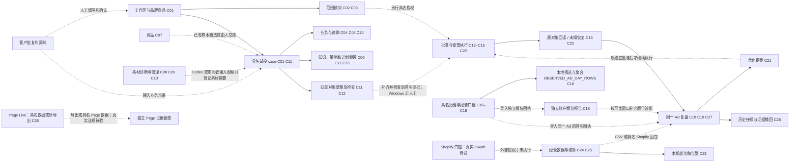

# V1 工作流依赖与交接

实线表示经过实际代码调用或同一任务状态读取。虚线写明人工操作、数据导入、外部授权或待验条件。图反映本机和受管合同，平台状态由具名回执证明。

## 实线的源码依据

| 连接 | 代码和读回 |
| --- | --- |
| 工作区 → 范围、具名试投 | client_workspace.health_check 读原工作区、media_buyer.run_case 和 _intake 复核客户标识与范围。 |
| 具名试投 → 业务/追踪/策略/草案 | media_buyer._intake 调用 business_readiness、tracking_audit、strategy_review、freeze_selection；同一 case 的 plan 阶段委托 first_launch_plan.prepare。 |
| 批准后的受管执行 → 回读 | first_launch_progress.progress 使用受管宿主并走 _recover_host_stage / _accept_readback；审批和提交按实际具名窗口。 |
| 原对象 → 同一 Ad 复盘与提案 | media_buyer._period_review 使用 progress 与 delivery_review；_proposal 根据该 case 的诊断和停止条件预览变更。 |
| 具名广告日归档 → 本地分层切片 | multi_account_review.insights_slice 筛选广告日粒度行，调用 analysis.aggregate_ads 本地汇总。 |
| 对账 → 看守 | commerce_watch.run 使用 commerce_csv.reconcile 有界轮次。 |
| 复盘 → 历史 | media_buyer.run_case 将已执行的本机回顾保存为原 case 状态；正式的版本化证据记录可另用 workspace-evidence。 |

视频默认在 0、约 1/3、约 2/3 时长处抽样，时间去重后最多三个。脚本输出帧、可提取的音轨、字幕时码、素材摘要和审阅页。Codex 或审阅者查看实际证据后，填写卖点、钩子、转化点、真人感四维观察，再通过 `--observations` 绑定到同一素材。结构化评语当前引用 `FRAME` 或 `SUBTITLE`，真人感须引用 `FRAME`。未提交观察的维度显示 `UNOBSERVED`。脚本校验素材摘要和证据引用，评语语义由审阅者判断。当前无 Meta 官方评分或广告效果评分。

Campaign → Ad Set → Ad 构成父子链，Ad 引用 Creative。多素材批次共享 Campaign 和 Ad Set，每条素材各有对应的 Creative 和 Ad 草案。

计划命令先生成并预填本地草案。Codex 按已审核的商品、预算、受众和文案补齐剩余字段，再用 `check_drafts`（`workspace-first-launch-check`）检查。具名审批和受管条件满足后才进入 PAUSED 创建及回读。草案预览、平台创建、启用投递及效果分别核对。

ABO/CBO 可作策略比较；本候选首投写入限 Ad Set（ADSET）日预算，Campaign 层预算无当前首投写入路径。

`account-insights-slice` 在本地筛选和聚合已归档的广告日粒度数据，结果依据标为 `OBSERVED_AD_DAY_ROWS`。这类切片的口径区别于平台原生父级去重 Insights；缺失的 reach/frequency 不据此推算。

`account-inventory-review` 核对已捕获的具名对象、父子关系和覆盖。账户版位读取用独立的版位报告（`workspace-plan --task ads-placements`）；同一 Ad 复盘使用具名广告和可比观察窗。分别保留来源、日期、币种、时区及覆盖。

[六类和逐项矩阵](capability-matrix.md) · [横向底座](07-cross-cutting-capabilities.md) · [证据登记](evidence-register.csv)

## 当前全链路接续

具名接入 → 方法及测量 → 素材选择 → 新建/续建/重建 → 暂停对象或人工接续 → 同广告回读 → 核算与素材学习。Shopify 与 Meta 原生来源在同窗报表汇合。
